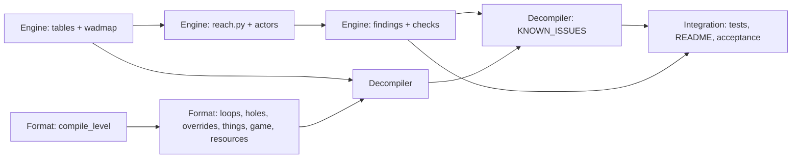

# Plan: WAD decompiler

Implements [decompiler-spec.md](decompiler-spec.md). Work happens on branch `decompiler` in `.worktrees/decompiler`, stacked on `iwad-env`.

## Baseline

Before any change, from the branch point:
- every level module built into `/tmp/decomp-base/wads/<module>.wad` (ZDBSP output is deterministic);
- `research/data/metrics_*.csv` regenerated into `/tmp/decomp-base/csv/` (identical to the main checkout's).

`/tmp/decomp-base/compare.sh` rebuilds every module and compares the WADs; `--csv` also regenerates and compares the CSVs.

## Slices

Three owners work in parallel in the same worktree. Files have one owner each; `levels/mapgen.py` is shared (Format owns the pipeline, Engine the checks section of `build()`).

### Engine (tables, reach model, checks)
Owns `levels/doom2.py`, `levels/wadmap.py`, `levels/reach.py`, `levels/checks.py`, `levels/measure.py` (except `check_sector_overlaps`), `scripts/metrics/*`.
1. Every vanilla thing type and line action into `levels/doom2.py`; the map parser into `levels/wadmap.py`; `doomwad.py` imports both. CSVs identical.
2. `progression_metrics.Model` and helpers into `levels/reach.py`, plus the actor parameter. CSVs identical.
3. `checks.findings(level, compiled) -> Findings(playability, style, warnings)` built on the reach model; `checks.explore` removed; `build()` applies `IMPORTED` and `KNOWN_ISSUES`; measurements reuse the model run, follow `level.game` (Ultimate Doom medians for Doom maps) and load `RESOURCES`. All modules still build byte-identical with no new errors.

### Format (builder)
Owns `levels/model.py`, `levels/wad.py`, `levels/preview.py`, `measure.check_sector_overlaps`, the pipeline in `levels/mapgen.py`.
1. `mapgen.compile_level(level) -> Compiled(lines, sides, lumps)`: the build steps up to the map lumps, used by `build()` and the decompiler.
2. Nesting-based loop roles and several outer loops; walls in holes; `Line`/`Side`/`OVERRIDES`; `Thing` `n` and `extra`; `level.game` and the game's IWAD; `RESOURCES` in `iwad_textures`; `WAD` in a subdirectory of `wads/`. All modules byte-identical.

### Decompiler
Owns `levels/decompile.py`, `levels/imported/` (generated, gitignored), the `.gitignore` entries.
Reading and merging, unclosed-sector repair, loop tracing, naming, field guessing, overrides via `compile_level`, helpers, module writer and header, `--verify`. Then `KNOWN_ISSUES` once `checks.findings` exists.

### Integration (lead)
Pytest suite in `tests/`, README and docstrings, the acceptance runs in the spec, review.
