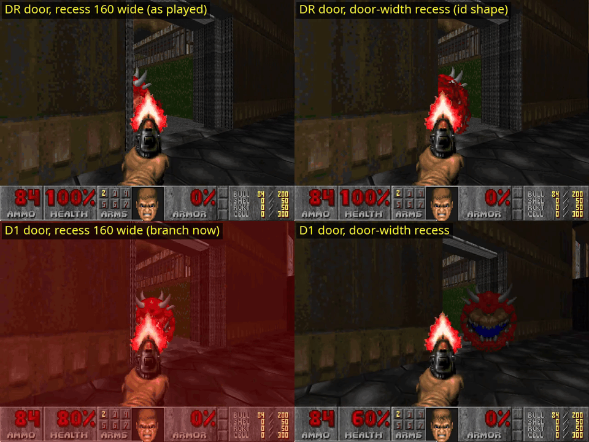
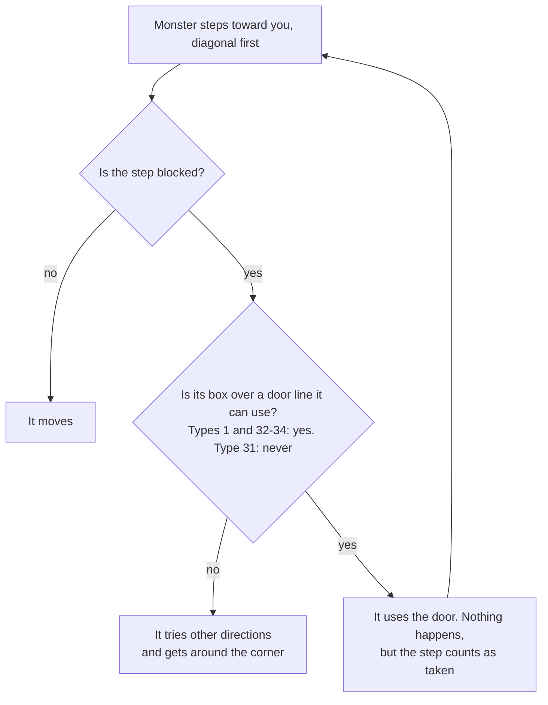
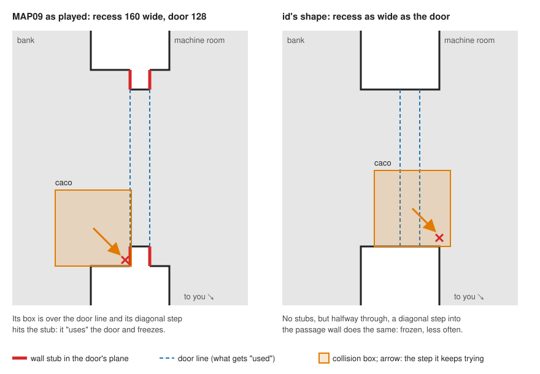
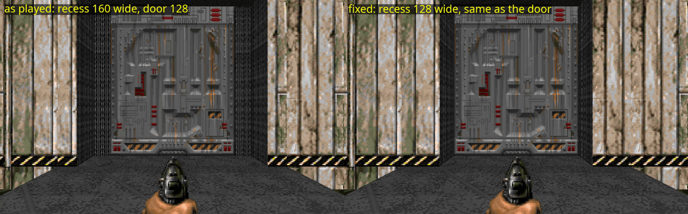

# Monsters stuck at doors

Under vanilla rules a monster chasing you through an open door can freeze in the doorway. It stops moving and can't see you around the wall, so it doesn't attack either. It stays there until you move. In MAP09's second playthrough (the 2024 re-release) a cacodemon froze this way at the machine room's west door.

This doc explains the cause, compares id's doors with ours, and measures what door shapes and door types do about it.



*The same demo on four builds of MAP09, 14 s in (see [In MAP09](#in-map09)). The top row's cacodemons are frozen in the doorway. The bottom row's are on their way to killing you.*

## DR and D1 doors

The letters say how a door is triggered and whether that repeats. **D**: you press use on the door itself. **R**: it works every time. **1**: it works once.

| Type | Door | Behaviour | Monsters |
|---|---|---|---|
| 1 | DR (`DR_DOOR`) | Opens, waits about 4 s (150 tics), closes. Use it again to reopen it. | Can open it, and can freeze at it |
| 31 | D1 (`D1_DOOR`) | Opens and stays open. | Can't use it |
| 26–28 | DR with a key (blue, yellow, red) | Like type 1, but needs the key. | Can't use them |
| 32–34 | D1 with a key (blue, red, yellow) | Like type 31, but needs the key. | Can't open them, but can still freeze at them |

Monsters never use a line flagged secret (`ML_SECRET`), whatever its type.

## Why the monster freezes

Each tic it chases, a monster tries to step `speed` units in its current direction (`P_Move`, `p_enemy.c`). Here is what happens when that step is blocked (Chocolate Doom's source, abridged):

```c
if (!numspechit)
    return false;              // blocked by plain walls: pick a new direction
actor->movedir = DI_NODIR;
good = false;
while (numspechit--)
{
    ld = spechit[numspechit];
    if (P_UseSpecialLine (actor, ld, 0))
        good = true;
}
return good;                   // used a special line: the step counts as taken
```

`spechit` holds the special lines the monster's box would cross on that step. For a monster, `P_UseSpecialLine` returns true on types 1 and 32–34 whatever the door does about it:

- **An open door stays as it is.** In `p_doors.c` the comment reads "bad guys never close doors".
- **A locked door doesn't open.** `EV_VerticalDoor` returns early for anything that isn't a player.



Next, the direction picker (`P_NewChaseDir`) tries the direct diagonal toward you first, whenever you're more than 10 units off its line in both x and y. It normally refuses to turn straight back the way it came, but the last direction was just cleared to `DI_NODIR`, so nothing rules the diagonal out. The monster tries the same blocked step and the same use on every move. It frees itself only when you move somewhere that changes which direction is the direct one.

How engines handle it:

| Engine | At the door |
|---|---|
| DOOM II v1.9, Chocolate Doom, dsda-doom and PrBoom+ at complevel 2 | Freezes |
| The 2024 re-release (KEX) | Froze in the MAP09 playthrough |
| Boom, MBF and their complevels | Fixed (MBF's `comp_doorstuck` option) |
| ZDoom, GZDoom, and ViZDoom (which the playtest bot runs on) | A random roll lets the monster turn, so it frees itself after a moment |

The playtest bot runs ViZDoom, so it never shows the freeze. The tests below play vanilla demos in dsda-doom instead.

id's maps have this bug too. The Doom Wiki covers it in [Monsters stuck in doortracks, walls or hanging off lifts](https://doomwiki.org/wiki/Monsters_stuck_in_doortracks,_walls_or_hanging_off_lifts), and its speedrun notes for E1M6, E2M3 and E2M4 mention monsters stalled on doortracks.

## The doorway's shape



`model.doorway()` used to build every recess 32 units wider than its door. That left a 16-unit stub of wall on each side of the door, in the door's own plane. You get the trap above whenever two things hold:

- you're off to one side of the doorway;
- a monster comes at the door off-centre and presses its box into a stub while the box is over the door line.

id's doors mostly don't have stubs: the passage is exactly as wide as the door. The table counts every door face monsters can use (types 1 and 32–34), taking each door line from the room it faces:

| Wall stub in the door's plane | DOOM II | DOOM | MAP09 as played | MAP01–08 before the fix |
|---|---|---|---|---|
| At neither end | 86% | 91% | 4% | 0–15% |
| At one end | 7% | 4% | 0% | 0–7% |
| At both ends | 7% | 5% | 96% | 79–100% |
| Door faces counted | 311 | 383 | 24 | 8–24 per map |

A stub counts if a wall continues in a straight line from the end of the door line on the room's side. "Wall" here also means a step too high to climb or an opening too low to pass.

## Testing door shapes

Each run is a v1.9 demo played by dsda-doom 0.30.1 (complevel 2, so vanilla rules) without rendering. The test map:

- **The monster's room:** 512×512, holding one monster.
- **The doorway under test:** a 128-wide door, already open as if you'd just come through.
- **Your room:** 512×512. You stand just inside it, 232 units off the door's line.

The run goes like this:

1. You fire for 20 tics, which wakes the monster, then hold forward against a closed door.
2. A line 48 units into your room that monsters can trigger (W1, type 4) opens that door when the monster crosses it.
3. You walk out over an exit line, and dsda's `-levelstat` records that the level ended.

With no monster in the map, the level never ends; that's the control.

Each row covers 1,120 runs, each lasting up to 45 s:
- 4 monsters: imp, demon, hell knight, cacodemon.
- 35 start points in the monster's room.
- 8 layouts: the map in 4 rotations (the blockmap's line order depends on direction), times you standing off to either side.

| Doorway | Door | Monster got through | Worst layout |
|---|---|---|---|
| Recess 160 wide, 32 deep before the door, 16 after (MAP09 as played) | DR | 32% | 1% |
| Same | D1 | 65% | 56% |
| Recess as wide as the door, 32 before, 16 after | DR | 62% | 32% |
| Recess as wide as the door, 16 before, 32 after | DR | 67% | 43% |
| Recess as wide as the door, either depth | D1 | 84% | 75% |
| No recess: door set flush in a wall | DR | 37% | 3% |
| Same | D1 | 82% | 74% |

What the numbers say:

- **The stubs are the problem, not the recess depth.** A flush door, whose walls carry on in the door's plane, is as bad as MAP09's recess (37% against 32%). Door-width recesses roughly double the through-rate, whichever way round the depths go.
- **Door-width recesses with DR doors only halve the problem.** They do about as well as D1 doors in MAP09's recesses, but monsters still freeze: in the worst layout only 32–43% got through. A monster halfway through the door can still press diagonally into the passage wall with its box over the door line (the right half of the plan above).
- **D1 doors make the freeze impossible.** Monsters can't use type 31, so a blocked one picks another direction. The misses left on the D1 rows are monsters that didn't find the opening within 45 s: vanilla chase logic heads straight for you and doesn't plan a route.

## In MAP09

All four builds play the same demo. MAP09's west door to the machine room is open, and you stand just inside the room, south of the door's line. One cacodemon waits on the bank. Skill is UV and you have only the pistol. You fire once, wait 8 s, turn to the doorway, and keep firing for 18 s.

| Door | Recess | What happens |
|---|---|---|
| DR | 160 wide (as played) | Freezes against the south stub. It never fires back and dies to the pistol at 26 s, after 46 rounds. You stay at 100%. |
| DR | As wide as the door | Freezes against the door track. It's still alive when the demo ends at 29 s, and you stay at 100%. |
| D1 | 160 wide | Comes through and kills you by 21 s. |
| D1 | As wide as the door | Comes through and kills you by 18 s. |

The videos are kept locally and not committed:
- `door-stuck/caco-stuck.mp4`: the first row, with sound.
- `door-stuck/four-variants.mp4`: all four side by side.

From the bank, a door-width recess looks almost the same. The DOORTRAK faces beside the door go, and the recess's DOORTRAK side walls take their place:



## Options

| Fix | Freezing | Cost |
|---|---|---|
| D1 doors | Impossible | Doors stay open once opened. Monsters can't open closed doors, so monsters behind one wait there until you open it. |
| Door-width recesses, DR doors | About half as likely, as in id's maps | The DOORTRAK faces beside each door go. |
| Both | Impossible, and monsters get through most often | Both of the above. |
| `ML_SECRET` on DR door lines | Impossible: monsters never use secret lines | Monsters can't open the doors, and the automap draws them as walls. |

Two more ideas, both ruled out:

- **Line order.** Whether a blocked step collects the door line at all depends on the order the engine checks lines: cell by cell through the 128-unit blockmap, then by line number within a cell. A map could perhaps arrange that, but the result changes with the monster's direction and with where the door sits on the grid, so it's too fragile to rely on.
- **A compatibility level.** A `COMPLVL` lump asking for MBF rules turns the fix on in ports that read the lump. Whether the 2024 re-release reads it is unverified, and MBF rules change other behaviour too.

### Choosing DR or D1 per door

Fixing the freeze isn't the only thing the door type changes. Each type makes a room harder in its own way:

| | DR | D1 |
|---|---|---|
| Before you open it | Monsters behind it can open it and come for you | Unvisited rooms stay sealed |
| After you open it | It shuts again, cutting off sight and sound | It stays open: chasers follow you, and every later shot carries through it and wakes more monsters |
| Retreating | It's shut behind you after about 6 s, and reopening it costs up to 0.8 s facing the door | The way back stays open |
| Your tools | Use an open DR door to slam it shut behind you | You can't close it |

The door timings are vanilla's for a 128-tall door: 2 units per tic, open at 1.8 s, closing from 6.1 s, too low to pass at about 7 s.

id used DR as the default and D1 deliberately. Counting two-sided door lines: DOOM II has 220 type 1 lines in 19 of its 32 maps and 45 type 31 in 15; DOOM has 327 type 1 in 27 of 36 maps and 89 type 31 in 25.

## Status

- **`model.doorway()`** builds every recess exactly as wide as its door, and every NUKAGE map is rebuilt with them. Of the 114 door faces monsters can use in MAP01–09 (secret doors left out, since monsters never use those), the share with a stub at both ends fell from 89% to 17%; 82% now have none, against 86–91% for id's maps. The 21 faces left are door sides with no recess at all, set flush in a wall: MAP01's and MAP02's start doors, for example, and MAP07's staff-wing doors.
- **SPEEDY1.WAD and SPEEDY2.WAD** are rebuilt with door-width recesses too; nothing else in them changed. Of their 48 door faces monsters can use, the share with a stub at both ends fell from 92% to 19%, and again what's left is door sides with no recess.
- **Door types:** every plain door is DR. MAP09's red door is DR with a key (type 28), which monsters can't use, and secret doors are `ML_SECRET`. Which doors, if any, should be D1 is left for a later analysis.
