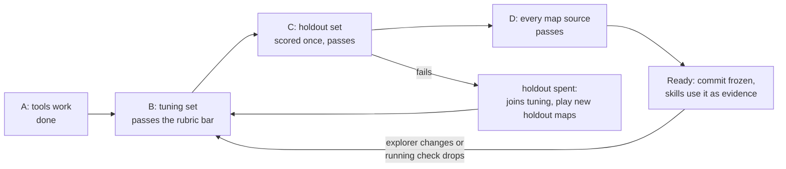

# Plan: the explorer bot, tested against blind human play

The `--explore` bot finds its own way through a map and reports where it stalls. The aim is for those stalls to stand in for where a first-time player searches, so the map-building skills can use them on every build without a person playing it. This plan covers how we test that against people playing maps blind, and the fixed bar that says when the explorer is ready to report to the skills.

The explorer's stalls describe a map; they don't grade it. Some getting lost is good, lure areas add fun and dimension, and a map with no wrong turns is one strangely shaped corridor. So the goal is not a bot that gets lost a lot, and not maps with no stalls. It's a bot that gets lost where people do, and only there.

Scoring rules: [explore-rubric.md](explore-rubric.md). Tool: `scripts/tools/compare.py`.

## Where it stands (2026-11-15, `6a964b7`)

| Piece | State |
|---|---|
| Explorer | Exits 34 of 61 id maps on seed 1, 30 on all three seeds; the 7 maps whose exit needs a boss to die aren't counted. Exits all six NUKAGE maps on every seed. Reads Boom generalized and extended line types. |
| Known blind spots | Running jumps, gun lines with no switch texture (barrel walls), timed doors and lifts it's too slow for, deliberate death pits, huge open areas it sweeps rather than reads |
| `--play` | Done: L marks "I'm lost", K stops; the report uses the explorer's own bookkeeping |
| Rubric and `compare.py` | v3 done: an L press marks the whole stretch it falls in; cause codes include B-perception |
| Blind plays | 1 so far: Flames at the Canyon (Obsidian), Partial. Lost recall 1/2, stall recall 2/3, precision 3/3, from saved traces under v2. Its only scored folder is v1 (`compare-e15e9ce`), so it needs scoring again at the current commit. |
| Not blind | OBSIDIAN01 MAP01 was analysed with the user, so it can't be in the pool. Its two 11-minute bot stalls are navigation bugs being fixed separately. |

## Ready means

The explorer is ready to report to the skills when gates B, C and D all pass **at one frozen explorer commit**. Until then its stalls are hints, as the doom-test skill says now.

The numbers below are fixed now, before the data. Changing one is a new version of this plan, and every play is checked again under it.

| Gate | Over | Must hold |
|---|---|---|
| **B** tuning | tuning plays, pooled (`compare.py --pool`) | ≥ 5 maps and ≥ 10 lost stretches; lost recall ≥ 60%; stall precision ≥ 50% |
| **C** holdout | holdout plays, scored once at the candidate commit | ≥ 3 maps and ≥ 5 lost stretches; lost recall ≥ 50%; stall precision ≥ 50% |
| **D** sources | tuning and holdout together, per source (Obsidian, SLIGE, community) | for every source with ≥ 3 lost stretches: lost recall ≥ 40%. A source that fails gets "not for this style" in the skills, rather than blocking the rest. |

Bot-limited plays (rubric section 5) don't count toward any gate.

## 1. The blind pool

A pool map must be one the user has never played or seen. That rules out their own levels, the id maps, OBSIDIAN01, and anything whose explorer report, `--describe` output, check output or top-down preview they've seen. The map must be a single map in Doom format (vanilla or Boom), since the explorer's map reader takes nothing else.

The pool comes from three sources, because each has a style and we can't let the bot learn one:

- **Obsidian:** `../doomedit/obsidian/obsidian.sh build seed=<fresh>`. Big, often outdoor, Boom line types.
- **SLIGE:** `../doomedit/slige/slige.sh -doom2`. Rooms and corridors, vanilla.
- **Community:** single-map PWADs from idgames (`research/fetch_idgames.py`). These are closest to hand-built maps like ours. The user picks from a list showing only title, author and year. The top-down SVGs in `research/maps/community/` are spoilers; agents don't open the SVG of a candidate map.

**First wave: 9 plays.** They're played in this source order: Obsidian, SLIGE, community, SLIGE, community, Obsidian, community, Obsidian, SLIGE. The canyon play is #1. **Every third play (#3, #6, #9 and so on) is holdout.** That's fixed before anyone sees a score, and it puts one map from each source in the holdout. The wave continues in the same pattern until gate B has its 10 lost stretches.

**Agents keep pool maps blind.** For a pool map, no agent runs `--explore`, `check_wad.py` or `--describe`, and none renders a preview or shows any of the map's contents until its play is recorded. Generating the WAD and starting `--play` is all an agent does before the play.

## 2. One play, start to finish

1. **Generate or fetch** the map; for a community map, the user confirms they don't know it.
2. **The user plays it:** `uv run --with vizdoom scripts/tools/playtest.py <WAD> MAP01 --play`. No monsters, god mode on. L when they realize they're lost, however late; K when they give up; 15 minutes at most. A play that is spoiled (crash, wrong controls, interrupted) is noted and dropped, not replayed.
3. **Ask about detours right away, while it's fresh:** was any stretch a deliberate detour (a secret, an item, sightseeing)? Those become `--choice M:SS-M:SS`.
4. **Score:** `compare.py <play folder> [--choice ...]`. For a holdout play, scoring happens only at a gate C check (see section 4).
5. **Give each mismatch a cause code** (rubric section 6). The agent proposes codes from frames of both demos at the stall times, and the user confirms them. Codes go in `compare-<commit>/codes.json`.

## 3. Tuning rounds

A round is one explorer change, aimed at the biggest bot-side cause.

1. **Choose a target:** add up the codes over the tuning plays, weighted by the stall time behind each. Work on the largest of B-lure, B-memory, B-perception, B-weak and B-blind. Work on a cause only if it shows up in at least 2 maps, so no change is tuned to one map. The canyon's north-east wander, probably a B-lure, waits for a second map. A B-memory or B-perception fix makes the bot "worse", so it must come from a human-like limit (rubric section 6), and the navigation checks in step 3 still apply.
2. **Make the change** on a branch, following the explorer's design rule: no knowledge of the map that a player wouldn't have.
3. **Check it:**
   - Score every tuning play again at the new commit.
   - Pooled lost recall and pooled stall precision must not drop.
   - The id-map acceptance batch is a navigation sanity check: the all-three-seeds exit count must not fall below 28 (it's 30 now). It runs on an AWS Spot instance, about $0.50 a run.
   - All six NUKAGE maps must still exit on every seed.
4. **Merge it, or drop it.** Every commit's scores stay in their own `compare-<commit>/` folders, so the history shows which changes helped.

Precision is the guard against overtuning. A bot that stalls everywhere would score well on lost recall and badly on precision.

## 4. Holdout checks

- **When:** gate C is checked only once gate B passes, at that commit. Holdout plays are recorded as they come, but they aren't scored or coded before then.
- **If it passes:** the commit is frozen.
- **If it fails:** the holdout maps are now spent, because their codes have been seen. They join the tuning set, and new holdout maps are played by the every-third rule before the next check.

**After readiness**, every new blind play is first scored at the frozen commit, before any tuning uses it. That's a running holdout. If lost recall over the last 5 of these falls below 50%, the explorer goes back to hints until it passes B, C and D again. Any change to the explorer after readiness means scoring every play again at the new commit, and B, C and D must still pass.

## 5. What the building skills get when it's ready

- **doom-test, section 6:** the explorer's recurring stalls become evidence instead of hints. Each is reported with its phase, place, length and how many seeds hit it, plus its likely cause. They're still descriptions. A stall leads to a change in the map only when it's unintended *and* unfair, and then the fix is a cue (a sightline, light, a texture), never a more linear map.
- **doom-design:** the design doc names its intended search spots and lures. doom-test matches recurring stalls against them: an intended one is noted, and only an unintended one is up for a cue.
- **Explore metrics:** these are computed at the frozen commit on the id maps and on a community reference set, and stored in `data/metrics/metrics_explore.csv`:
  - median exit time
  - number of recurring stalls
  - longest recurring stall
  - recurring stall time as a share of the run

  A built map's numbers are read against the id and community ranges, as the balance metrics are. It's a band, not a target: a map far below it (too linear) is as notable as one far above.
- **`docs/builder.md`** documents all of the above.

## 6. Work list

- [ ] Score the canyon play again at the current commit under rubric v3.
- [ ] `compare.py`: read `codes.json`, add the codes up by stall time in `--pool`, and mark plays as tuning or holdout (from the every-third rule, stored in the play's `meta.json`). `--pool` reports the two sets separately, and holdout scores stay hidden until a gate C check.
- [ ] `compare.py --pool` reports gates B, C and D.
- [ ] Play the first wave (plays #2–#9; the canyon is #1).
- [ ] A cloud batch that scores every play again at a new commit (the AWS Spot setup from the acceptance batch).
- [ ] Tuning rounds until gate B passes, then gate C, then gate D.
- [ ] At readiness: `metrics_explore.csv` for the id maps and the community reference set, then the doom-test, doom-design and builder.md changes.

## 7. Risks and open questions

- **One player:** with only the user, this tests how well the bot predicts the user. A second blind player would test it on people in general. Whether to look for one is open.
- **Blindness wears off:** the user learns each generator's habits. That's another reason community maps are a third of the pool. If a generator starts to feel predictable, the user should say so, and its later plays should be read with that in mind.
- **No monsters:** fighting changes where people go and how long they stay. A later rubric version could score `--monsters` plays.
- **The bot never gives up:** a person quits and the bot doesn't, so S1 will often fail where the person gave up. It isn't part of gates B–D.
- **Cost:** each play takes about 10–15 minutes of the user's time. Each `compare.py` run takes about 3–4 minutes and 8 CPU-minutes locally. Scoring all plays again on each explorer change belongs in the cloud batch.
- **The thresholds are guesses:** they were set before any data. If they're plainly wrong, they change through a new version of this plan, never by fitting them to results.
