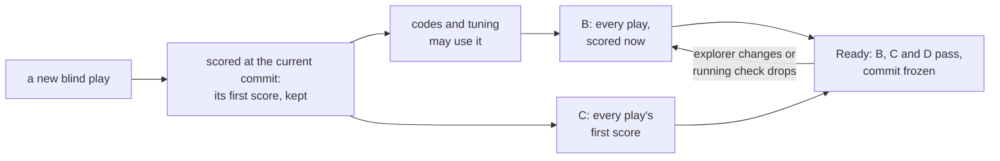

# Plan: the explorer bot, tested against blind human play (v4)

The `--explore` bot finds its own way through a map and reports where it stalls. The aim is for those stalls to stand in for where a first-time player searches, so the map-building skills can use them on every build without a person playing it. This plan covers how we test that against people playing maps blind, and the fixed bar that says when the explorer is ready to report to the skills.

The explorer's stalls describe a map; they don't grade it. Some getting lost is good, lure areas add fun and dimension, and a map with no wrong turns is one strangely shaped corridor. So the goal is not a bot that gets lost a lot, and not maps with no stalls. It's a bot that gets lost where people do, and only there.

Scoring rules: [explore-rubric.md](explore-rubric.md). Tool: `scripts/tools/compare.py`.

Versions: **v1** (2026-11-15) the plan as first written. **v2** (2026-11-17) SLIGE's share of the pool from play #14 on (section 1). **v3** (2026-11-17) every play's first score is out of sample, so gate C is taken over those instead of a holdout third; `--pool` shows 95% ranges (section "Ready means"). **v4** (2026-11-19) a map that isn't representative of DOOM maps in general can be ruled out of scope; #16 is (section 1).

## Where it stands (2026-11-18, `1ed823f`)

| Piece | State |
|---|---|
| Explorer | Exits 36 of 61 id maps on seed 1, 32 on all three seeds; the 7 maps whose exit needs a boss to die aren't counted. Exits all six NUKAGE maps on every seed. Reads Boom generalized and extended line types, and since `1ed823f` treats Boom generalized lifts as lifts (OBSIDIAN02 and 10 now exit). |
| Known blind spots | Running jumps, gun lines with no switch texture (barrel walls), timed doors and lifts it's too slow for, deliberate death pits, huge open areas it sweeps rather than reads. Diagnosed, not fixed (one note per map in [explorer-notes/](explorer-notes/)): a lift's own switch off every route (a lift booth, a switch plate under a lift, a ring of teleport pedestals; a first fix, branch `explorer-liftsw`, was dropped: it fixed none of SELFISH5, OBSIDIAN04, Marbellous and slowed NUKAGE); a short gap from a crate onto a ledge (monlth04); raised teleport pads it walks into (Marbellous); lift 564 on The transport tycoon's epic fall. |
| `--play` | Done: L marks "I'm lost", K stops; the report uses the explorer's own bookkeeping |
| Rubric and `compare.py` | v4: an L press marks the whole stretch it falls in; a detour (`--choice`) removes only its own time; cause codes include B-perception. `--pool` reports the gates |
| Blind plays | 28 played (#1–#28; SJS2 spoiled; #17–#28 from the play queue). Bot-limited (rubric section 5, per commit in `meta.json` "bot_limited"): #5 CHORD_NG, #18 Tantrum 2, #22 DeathBelow, and #6 OBSIDIAN02 until `1ed823f`. At `1ed823f`: gate B lost recall 15/29 = 52% (34–69%), precision 43/68 = 63%; on the same 24 plays as before it, recall 15/27 both times and precision 41 → 42 of 66. Gate C (first scores) 14/27 = 52% (34–69%), precision 41/66: passes. Gate D passes. B doesn't. The largest causes by stall time: B-weak (lift switches, the crate gap) and B-perception (4 maps each). |
| Not blind | OBSIDIAN01 MAP01 was analysed with the user, so it can't be in the pool. Its two 11-minute bot stalls are navigation bugs being fixed separately. |

## Ready means

The explorer is ready to report to the skills when gates B and D pass **at one frozen explorer commit** and gate C passes over the first scores. Until then its stalls are hints, as the doom-test skill says now.

**Why first scores (v3).** The bot never sees a person's play, so the only way a play stops being a fair test is that someone tunes the explorer after looking at it. A play's first score is computed by `compare.py` before anyone watches its replays or codes it, so it's out of sample whatever commit it was made at. v1 and v2 kept that only for every third play (the holdout). With one player getting lost about once a map, that left gate C deciding on 5 lost stretches, close to a coin flip: a bot whose real lost recall is 53% fails a 3-of-5 bar 44% of the time. First scores make every play count toward C. The cost: they come from whatever commit was current when each play was made, so C measures the explorer as it was improved, not one frozen commit; while tuning rounds help, older first scores understate the current explorer.

The numbers below are fixed now, before the data. Changing one is a new version of this plan, and every play is checked again under it. `--pool` prints each rate with its 95% range: with tens of lost stretches, a rate is known only to about ±20 points, so a gate passing or failing by a few points is not a finding on its own.

| Gate | Over | Must hold |
|---|---|---|
| **B** now | every counted play, scored at the candidate commit (`compare.py --pool`) | ≥ 5 maps and ≥ 10 lost stretches; lost recall ≥ 60%; stall precision ≥ 50% |
| **C** first scores | every counted play's first score (`meta.json` "first") | ≥ 15 lost stretches; lost recall ≥ 50%; stall precision ≥ 50% |
| **D** sources | every counted play, scored at the candidate commit, per source (Obsidian, SLIGE, community) | for every source with ≥ 3 lost stretches: lost recall ≥ 40%. A source that fails gets "not for this style" in the skills, rather than blocking the rest. |

Bot-limited plays (rubric section 5) and out-of-scope plays (section 1) don't count toward any gate.

The lost-stretch minimums are the evidence each gate needs, not a quota for the player. A play where the user never gets lost still counts: toward the map minimums, toward order, and toward stall precision, since a recurring bot stall on a map they breezed through is a false alarm. The minimums can't be dropped, though. A bot that never stalls has no recurring stalls, so its precision passes as n/a, and only lost recall catches it.

**Stopping rule:** if 15 maps give fewer than 10 lost stretches, stop playing. That itself is a finding: maps of these kinds rarely lose this player. The plan is then rewritten around it (for instance, whether the explorer's job narrows to not raising false alarms) as a new version, before any more plays. (Not reached: 15 maps gave 19.)

## 1. The blind pool

A pool map must be one the user has never played or seen. That rules out their own levels, the id maps, OBSIDIAN01, and anything whose explorer report, `--describe` output, check output or top-down preview they've seen. The map must be a single map in Doom format (vanilla or Boom), since the explorer's map reader takes nothing else.

**Out of scope (v4).** The pool stands for DOOM maps in general. A map the user rules isn't representative of them (an avant-garde one) counts toward no gate; its play is kept, with the reason in `meta.json` "out_of_scope". So far: #16, The transport tycoon's epic fall, which opens with a plane crash and then runs down a highway.

The pool comes from three sources, because each has a style and we can't let the bot learn one:

- **Obsidian:** `../doomedit/obsidian/obsidian.sh build seed=<fresh>`. Big, often outdoor, Boom line types.
- **SLIGE:** `../doomedit/slige/slige.sh -doom2`. Rooms and corridors, vanilla.
- **Community:** single-map PWADs from idgames (`research/fetch_idgames.py`). These are closest to hand-built maps like ours. The user picks from a list showing only title, author and year. The top-down SVGs in `research/maps/community/` are spoilers; agents don't open the SVG of a candidate map.

**First wave: 9 plays.** They were played in this source order: Obsidian, SLIGE, community, SLIGE, community, Obsidian, community, Obsidian, SLIGE. The canyon play is #1. Under v1 and v2, every third play (#3, #6, #9 and so on) was holdout; v3 drops that split (see "Ready means").

**From play #14 (plan v2, 2026-11-17):** SLIGE maps rarely lose this player (1 lost stretch in plays #2, #4, #9 and #11, each under 2 minutes), so SLIGE drops from 1 play in 3 to 1 in 6. The order from #14 repeats: community, Obsidian, community, SLIGE, community, Obsidian. #13 should have been SLIGE under the first-wave pattern but was played as Obsidian (an agent's slip, made before its score was seen); it stays as played.

**Agents keep pool maps blind.** For a pool map, no agent runs `--explore`, `check_wad.py` or `--describe`, and none renders a preview or shows any of the map's contents until its play is recorded. Generating the WAD and starting `--play` is all an agent does before the play.

## 2. One play, start to finish

1. **Generate or fetch** the map; for a community map, the user confirms they don't know it.
2. **The user plays it:** `uv run --with vizdoom scripts/tools/playtest.py <WAD> MAP01 --play`, or a run of queued maps back to back with `scripts/tools/play_queue.py` (docs/builder.md). No monsters, god mode on. Play naturally, heading for the exit; never try to get lost, and never press L more freely to help the count. L when they realize they're lost, however late; K when they give up; the play stops itself at 15:00. A play that is spoiled (crash, wrong controls, interrupted) is noted and dropped, not replayed.
3. **Note detours right away, while they're fresh:** was any stretch a deliberate detour (a secret, an item, sightseeing)? The queue asks after each map; for a detour it opens a video of the play and asks for the times, which go in the play's `meta.json` as `choice` and become `--choice M:SS-M:SS` when it's scored.
4. **Score**, any time before step 5: `compare.py <play folder> [--choice ...]` at the current commit. Queued plays are scored together afterwards. The first time a pool play is scored, `compare.py` stores that score in its `meta.json` as "first"; that is the play's out-of-sample score and never changes. Plays #1–#16 had theirs filled in from their earliest score under rubric v3 or later (#14's from `26675f0`, the same explorer code as its first score but rubric v4, which counts its L press before the detour).
5. **Give each mismatch a cause code** (rubric section 6), only after step 4. The agent proposes codes from frames of both demos at the stall times, and the user confirms them. Codes go in `compare-<commit>/codes.json`.

## 3. Tuning rounds

A round is one explorer change, aimed at the biggest bot-side cause.

1. **Choose a target:** add up the codes over every play, weighted by the stall time behind each. Work on the largest of B-lure, B-memory, B-perception, B-weak and B-blind. Work on a cause only if it shows up in at least 2 maps, so no change is tuned to one map. A B-memory or B-perception fix makes the bot "worse", so it must come from a human-like limit (rubric section 6), and the navigation checks in step 3 still apply.
2. **Make the change** on a branch, following the explorer's design rule: no knowledge of the map that a player wouldn't have.
3. **Check it:**
   - Score every play again at the new commit (its first score stays as it was).
   - Pooled lost recall and pooled stall precision must not drop.
   - The id-map acceptance batch is a navigation sanity check: the all-three-seeds exit count must not fall below 28 (it's 32 now).
   - All six NUKAGE maps must still exit on every seed.
   - All of these run on one AWS Spot instance, about $1 an hour, not on the local machine: `python3 scripts/tools/cloud.py run NAME --commit C --rescore --idmaps --nukage` uploads the repo and the plays, runs them, copies each play's `compare-C/` folder back, deletes the instance and prints the exits. `cloud.py resume NAME` picks it up after this machine stops; the instance shuts itself down after `--hours` regardless.
4. **Merge it, or drop it.** Every commit's scores stay in their own `compare-<commit>/` folders, so the history shows which changes helped.

Precision is the guard against overtuning. A bot that stalls everywhere would score well on lost recall and badly on precision.

## 4. Out-of-sample checks

- **Gate C** is read off every play's first score, whenever `--pool` runs; nothing is hidden, because a first score is fixed before anyone sees it.
- **When B, C and D all pass,** the commit is frozen.
- **After readiness,** every new play's first score is at the frozen commit. That's a running check: if lost recall over the last 5 such plays falls below 50%, the explorer goes back to hints until it passes B, C and D again. Any change to the explorer after readiness means scoring every play again at the new commit, and B, C and D must still pass.

## 5. What the building skills get when it's ready

- **doom-test, section 6:** the explorer's recurring stalls become evidence instead of hints. Each is reported with its phase, place, length and how many seeds hit it, plus its likely cause. They're still descriptions. A stall leads to a change in the map only when it's unintended *and* unfair, and then the fix is a cue (a sightline, light, a texture), never a more linear map.
- **doom-design:** the design doc names its intended search spots and lures. doom-test matches recurring stalls against them: an intended one is noted, and only an unintended one is up for a cue.
- **Explore metrics:** these are computed at the frozen commit on the id maps and on a community reference set, and stored in `data/metrics/metrics_explore.csv`:
  - median exit time
  - number of recurring stalls
  - longest recurring stall
  - recurring stall time as a share of the run

  A built map's numbers are read against the id and community ranges, as the balance metrics are. It's a band, not a target: a map far below it (too linear) is as notable as one far above.
- **`docs/builder.md`** documents all of the above.

## 6. Work list

- [x] Score the canyon play again at the current commit under rubric v3.
- [x] `compare.py`: read `codes.json`, add the codes up by stall time in `--pool`.
- [x] `compare.py --pool` reports gates B, C and D, with 95% ranges; gate C over first scores (v3).
- [x] Play the first wave (plays #2–#9; the canyon is #1). #5 (CHORD_NG) is Bot-limited; SJS2 was spoiled (interrupted) and dropped.
- [ ] Code the mismatches (about 40 over 15 maps; Grime's are done).
- [ ] A cloud batch that scores every play again at a new commit (the AWS Spot setup from the acceptance batch).
- [ ] Tuning rounds until gates B, C and D pass.
- [ ] At readiness: `metrics_explore.csv` for the id maps and the community reference set, then the doom-test, doom-design and builder.md changes.

## 7. Risks and open questions

- **One player:** with only the user, this tests how well the bot predicts the user. A second blind player would test it on people in general. Whether to look for one is open.
- **Blindness wears off:** the user learns each generator's habits. That's another reason community maps are a third of the pool. If a generator starts to feel predictable, the user should say so, and its later plays should be read with that in mind.
- **No monsters:** fighting changes where people go and how long they stay. A later rubric version could score `--monsters` plays. Corpses also act as waypoints: in a real play the bodies left behind mark where you've been, which makes a loop easier to spot (the user, after replaying CHORD_NG with monsters). Without them, rooms that look alike stay alike, so no-monster plays likely get the user lost more than normal play would. That leans toward B-memory, since the bot never forgets floor it has seen and doesn't need corpses.
- **The bot never gives up:** a person quits and the bot doesn't, so S1 will often fail where the person gave up. It isn't part of gates B–D.
- **Cost:** each play takes about 10–15 minutes of the user's time. Each `compare.py` run takes about 3–4 minutes and 8 CPU-minutes locally. Scoring all plays again on each explorer change belongs in the cloud batch.
- **Small numbers:** this player gets lost about 1.2 times a map, so each gate rests on tens of lost stretches and its rates are known to about ±20 points. Narrowing that to ±10 would take about 95 lost stretches, some 80 plays from one player. Gates passing or failing by a few points should be read with the ranges `--pool` prints.
- **The thresholds are guesses:** they were set before any data. If they're plainly wrong, they change through a new version of this plan, never by fitting them to results.
